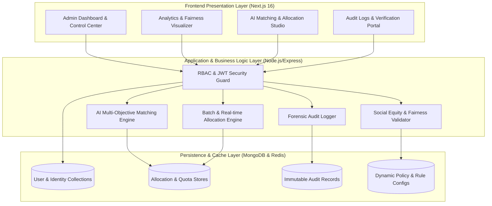
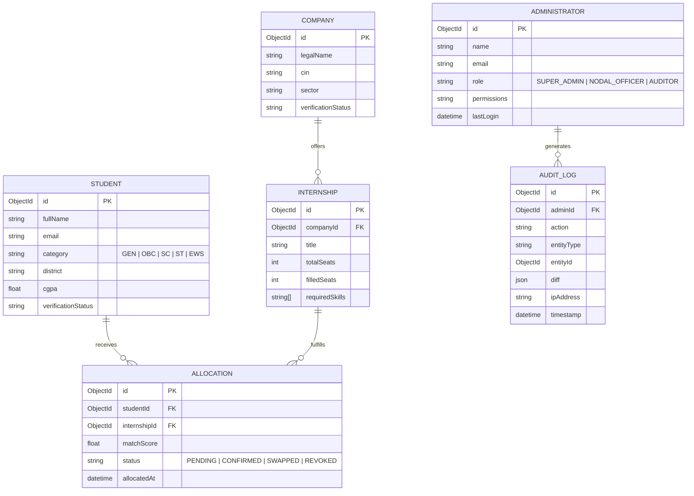

# PM Internship Scheme — AI Smart Allocation Engine
## Comprehensive Admin Panel Technical & Project Report

---

### Executive Summary

The **Admin Panel of the AI-Based Smart Allocation Engine** serves as the central mission-control dashboard for ministry administrators, nodal officers, and governance bodies overseeing the **Prime Minister's Internship Scheme (PMIS)**.

The system is engineered to solve large-scale internship allocation challenges across India by harmonizing:
1. **Candidate Merit & Readiness:** AI skill scores, academic performance, and internship preferences.
2. **Affirmative Action & Social Equity:** Ensuring equitable representation across Tier-2/Tier-3 towns, aspirational districts, gender balance, and reserved categories.
3. **Industry Capacity & Sector Demands:** Real-time quota management across corporate partners, MSMEs, and public sector undertakings.
4. **Governance, Auditing & Fraud Prevention:** Immutable audit logging, digital verification (DigiLocker/QR), geo-tagged attendance check-ins, and grievance mitigation.

---

## 1. System Architecture & Tech Stack



### Core Technologies:
- **Frontend Framework:** Next.js 16 (App Router, Turbopack, React 19)
- **UI & Styling:** Tailwind CSS 4, Radix UI Primitives, Lucide Icons
- **Data Visualization:** Recharts, Interactive Responsive Charts
- **Backend API:** Node.js, Express.js, TypeScript 5.x
- **Database:** MongoDB with Mongoose ODM
- **Security & Integrity:** Helmet, CORS, Rate Limiting, JWT RBAC, Bcrypt Password Hashing

---

## 2. Comprehensive Admin Modules & Functional Breakdown

The Admin Panel contains **21 dedicated micro-modules** categorized into 6 core operational pillars:

```
Admin Control Center
 ├── 1. Governance & Oversight
 │    ├── Executive Dashboard (/admin/dashboard)
 │    ├── Administrator RBAC (/admin/administrators)
 │    ├── Policy & Rule Configuration (/admin/rules)
 │    └── System Settings (/admin/settings)
 ├── 2. Candidate & Identity Verification
 │    ├── Candidate Registry (/admin/students)
 │    ├── DigiLocker / QR Verification (/admin/verification)
 │    └── Applications Overseer (/admin/applications)
 ├── 3. Industry & Capacity Management
 │    ├── Partner Companies Directory (/admin/companies)
 │    ├── Internship Listings (/admin/internships)
 │    └── Seat Matrix & Capacity Planning (/admin/capacity)
 ├── 4. Smart Allocation & Optimization
 │    ├── AI Matching Engine (/admin/ai-matching)
 │    ├── Batch Allocations (/admin/allocations)
 │    ├── Dynamic Reallocation (/admin/reallocation)
 │    └── Peer Mutual Swaps (/admin/swaps)
 ├── 5. Operations & Monitoring
 │    ├── Geo Check-in & Attendance (/admin/check-in)
 │    ├── Stakeholder Feedback (/admin/feedback)
 │    └── Learning Outcomes & PPO Tracking (/admin/outcomes)
 └── 6. Compliance, Audit & Analytics
      ├── Affirmative Action & Fairness Index (/admin/fairness)
      ├── Predictive Analytics & Intelligence (/admin/analytics)
      ├── Forensic Audit Trail (/admin/audit-logs)
      └── Ministry Reports & Exports (/admin/reports)
```

---

### Module 1: Executive Dashboard (`/admin/dashboard`)
- **Key Metrics Tracked:** Total candidates registered, verified companies, active internship listings, total seats allocated, overall fill rate, and fairness index.
- **Visual Widgets:**
  - Application status distribution (Under Review, Matched, Allocated, Rejected).
  - Real-time sector-wise allocation progress bar.
  - Urgent alerts panel (pending verifications, capacity bottlenecks, unresolved swap requests).

### Module 2: AI Matching Engine (`/admin/ai-matching`)
- **Objective:** Automated, bias-free candidate-to-internship pairing.
- **Mathematical Multi-Objective Scoring:**
  $$\text{MatchScore} = w_1 \cdot S_{\text{skills}} + w_2 \cdot S_{\text{location}} + w_3 \cdot S_{\text{equity}} + w_4 \cdot S_{\text{academic}} - \text{Penalty}_{\text{mismatch}}$$
  - $w_1$ (Skill Alignment): Semantic similarity between student skill evidence and role JD.
  - $w_2$ (Geographic Affinity): Proximity preference, district-level quota compliance.
  - $w_3$ (Social Equity Weight): Boost factors for aspirational districts, female candidates in STEM, and marginalized communities.
  - $w_4$ (Academic & Assessment): Standardized assessment test scores.
- **Controls:** Ability to simulate matching rounds, preview rank lists, adjust weight sliders, and trigger final batch allocations.

### Module 3: Digital Verification & Fraud Prevention (`/admin/verification`)
- **Capabilities:**
  - Automated verification status dashboard (Verified, Pending, Flagged/Failed).
  - Integration checkpoints for DigiLocker credential proofs and QR-code verified documents.
  - One-click manual override with mandatory audit remarks for flagged documents.

### Module 4: Affirmative Action & Fairness Visualizer (`/admin/fairness`)
- **Compliance Metrics:**
  - Social Category Quota (SC / ST / OBC / EWS / General).
  - Gender Inclusivity Index (Targeting >40% female participation in key technical cohorts).
  - Geographic Dispersion Index (Ensuring Tier-2 & Tier-3 candidates represent ≥55% of distributed opportunities).
  - Gini Coefficient representation for balanced rural-urban seat distribution.

### Module 5: Capacity Planning & Seat Matrix (`/admin/capacity`)
- **Features:**
  - Sector-wise allocation limits (IT/Software, Manufacturing, BFSI, Healthcare, Renewable Energy).
  - Corporate intake quotas with alerts for under-subscribed or over-subscribed roles.
  - Multi-company quota rebalancing simulation.

### Module 6: Reallocation & Mutual Swaps (`/admin/reallocation` & `/admin/swaps`)
- **Reallocation Engine:** For candidates who dropped out or could not join due to geographical displacement.
- **Peer-to-Peer Mutual Swaps:** AI-assisted validation where two students mutually exchange allocations without violating company criteria or quota balances.
- **Admin Workflow:** Review justification, review eligibility delta, approve or reject with timestamped reasons.

### Module 7: Check-In, Attendance & Monitoring (`/admin/check-in`)
- **Features:**
  - Geo-tagged mobile check-ins and monthly milestone tracking.
  - Status indicators: Verified Attendance, Disputed Location, Inactive/Absent.
  - Alerts for prolonged non-attendance triggering stipends or mentor interventions.

### Module 8: Forensic Audit Logs (`/admin/audit-logs`)
- **Integrity Compliance:**
  - Complete, unalterable event history: Action, Performed By (Admin ID/Role), Target Entity, IP Address, Timestamp, Before/After Snapshot diffs.
  - Filterable by module, severity (Info, Warning, Critical), and date ranges.

### Module 9: Analytics, Intelligence & Reports (`/admin/analytics` & `/admin/reports`)
- **Predictive Analytics:** Drop-out probability indicator based on early attendance, skill gap, and commute metrics.
- **Reporting Engine:** Generate instant PDF/Excel exports for Ministry of Corporate Affairs (MCA) compliance.

---

## 3. Database Schema Overview



---

## 4. Key REST API Endpoints (Admin Specific)

| Endpoint | Method | Role Required | Description |
| :--- | :--- | :--- | :--- |
| `/api/admin/dashboard` | `GET` | Admin, Auditor | Retrieves overall KPIs, charts, and summary statistics |
| `/api/admin/administrators` | `GET, POST` | Super Admin | Manage admin users and assign permissions |
| `/api/matching/run` | `POST` | Admin | Triggers AI batch matching algorithm |
| `/api/matching/simulate` | `POST` | Admin | Runs dry-run simulation of weights without committing |
| `/api/allocations/publish` | `POST` | Admin | Finalizes and publishes allocations to students/companies |
| `/api/allocations/swaps/approve` | `POST` | Admin | Approves a mutual candidate swap request |
| `/api/students/verify/:id` | `PATCH` | Admin, Verifier | Approves or rejects student verification credentials |
| `/api/fairness/metrics` | `GET` | Admin, Auditor | Computes social equity and diversity scorecards |
| `/api/audit-logs` | `GET` | Super Admin, Auditor | Queries immutable audit log repository |
| `/api/reports/generate` | `POST` | Admin | Exports structured PDF/CSV ministry reporting packs |

---

## 5. Security & Compliance Highlights

1. **Role-Based Access Control (RBAC):**
   - **Super Admin:** Full system authority, admin user management, rule tweaking.
   - **Nodal Officer / Regional Admin:** Geographic slice access, candidate verification, company on-boarding.
   - **Auditor:** Read-only access to audit logs, fairness metrics, and allocations.
2. **Defensive Validation & Sanitization:**
   - Strict Zod payload validation on all requests.
   - Helmet HTTP headers enabled (CSP, HSTS, frameguard against clickjacking).
   - Rate limiting on sensitive endpoints (brute-force defense).
3. **Data Integrity & Traceability:**
   - Soft deletes on critical records with audit reasons.
   - Diff capturing on every administrative override.

---

## 6. Conclusion & Submission Readiness

The **PMIS Smart Allocation Admin Panel** delivers a production-grade, highly scalable platform designed to meet national-level deployment standards. 

Its combination of **AI-driven optimization, strict fairness compliance, and comprehensive auditability** ensures that every internship seat is allocated equitably, transparently, and efficiently.
